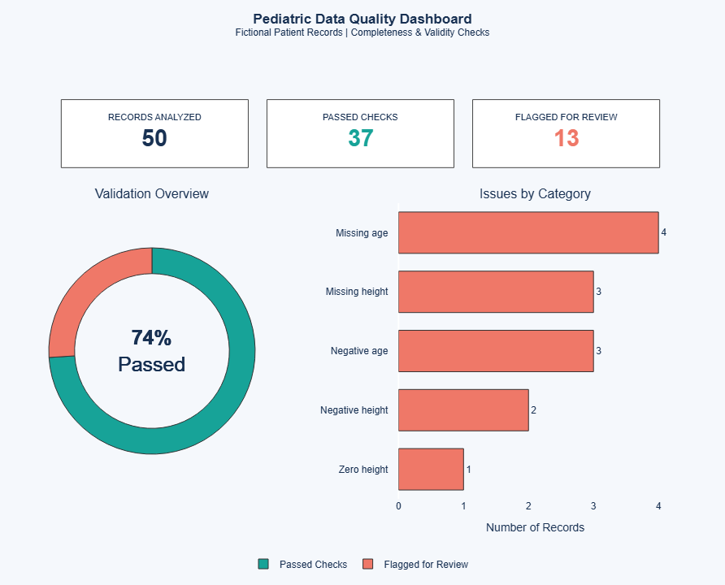

# cintel-02-static-anomalies

[](pyproject.toml)
[](https://github.com/ssowers2/cintel-02-static-anomalies-sowers/actions/workflows/ci-python-zensical.yml)
[](https://ssowers2.github.io/cintel-02-static-anomalies-sowers/)
[](https://docs.astral.sh/uv/)
[](https://zensical.org/)
[](LICENSE)

> Exploring static anomaly detection and pediatric data quality validation using Python, Polars, and Plotly.

**Author:** Sabriya Sowers
**Date:** October 2026
**Course:** Continuous Intelligence — Project 02

## Pediatric Data Quality Dashboard

[](https://ssowers2.github.io/cintel-02-static-anomalies-sowers/)

**[View the Interactive Dashboard](https://ssowers2.github.io/cintel-02-static-anomalies-sowers/)**

The dashboard summarizes automated validation of 50 fictional pediatric patient records:

- **50** records analyzed
- **37** records passed the defined checks (**74%**)
- **13** records flagged for review (**26%**)
- **5** categories of data quality issues evaluated

Click the screenshot to explore the interactive Plotly dashboard on GitHub Pages.

## Project Overview

This project demonstrates how Python can identify unusual, missing, and invalid values in structured healthcare data. It includes three stages:

- **D1 — Original Example:** Run a static anomaly detection pipeline using predefined thresholds.
- **D2 — Custom Experiment:** Adjust the height threshold and compare results.
- **D3 — Custom Application:** Build a separate pediatric data quality validation pipeline and interactive dashboard.

All records are fictional and used for educational purposes. No real patient information or protected health information (PHI) is included.

## D1: Original Static Anomaly Detection

The original dataset contains **22 fictional pediatric clinic observations**, with two fields:

- `age_years` — patient age in years
- `height_inches` — patient height in inches

The original pipeline flags records where **age is at least 16 years** or **height is at least 72 inches**.

**Original result:** 3 of 22 records were flagged. These thresholds are instructional examples, not clinical standards.

## D2: Custom Threshold Experiment

I lowered the height threshold from **72 inches to 70 inches**, keeping the age threshold unchanged, to investigate how a small rule change affects the results.

| Measurement | Original | Modified |
|---|---:|---:|
| Age threshold | 16 years | 16 years |
| Height threshold | 72 inches | 70 inches |
| Records analyzed | 22 | 22 |
| Records flagged | 3 | 4 |

**Finding:** Lowering the height threshold flagged one additional record. This illustrates why screening rules and their changes should be carefully defined and documented.

## D3: Custom Pediatric Data Quality Validation

### Objective and Dataset

I created a separate application to detect missing or invalid values before data is used for reporting and analysis. Unlike the original example, this application focuses on **data completeness and basic validity**, not unusually high measurements.

The custom dataset contains **50 synthetic pediatric records** with `age_years` and `height_inches` fields.

[View the custom pediatric dataset](data/pediatric_quality_data.csv)

### Validation Rules

Using Python and Polars, the pipeline identifies five issue categories:

1. Missing age
2. Missing height
3. Negative age
4. Negative height
5. Zero height

Flagged records are saved to [`artifacts/pediatric_quality_issues.csv`](artifacts/pediatric_quality_issues.csv).

### Validation Results

| Data quality issue | Records flagged |
|---|---:|
| Missing age | 4 |
| Missing height | 3 |
| Negative age | 3 |
| Negative height | 2 |
| Zero height | 1 |
| **Total** | **13** |

**37 of 50 records (74%) passed** the defined checks; **13 (26%) were flagged**. Missing age was the most frequently identified issue.

### Interactive Dashboard

The Plotly dashboard presents KPI cards, a pass-versus-flagged donut chart, an issue-category bar chart, and interactive tooltips.

[Open the interactive dashboard on GitHub Pages](https://ssowers2.github.io/cintel-02-static-anomalies-sowers/)

### Limitations

The application checks five basic conditions but does not assess age-specific clinical expectations. Each flagged record receives only its first detected issue, so additional issues within the same record may not be reported. Passing these checks does not guarantee clinical accuracy or overall data quality.

## Project Structure

| File or folder | Purpose |
|---|---|
| `data/clinic_data.csv` | Original fictional pediatric dataset |
| `data/pediatric_quality_data.csv` | Custom 50-record dataset |
| `src/cintel/anomaly_detector.py` | Original and modified threshold-based pipeline |
| `src/cintel/pediatric_quality.py` | Custom data quality validation pipeline |
| `src/cintel/pediatric_dashboard.py` | Plotly dashboard generator |
| `src/cintel/utils_clinic.py` | Shared clinic data processing functions |
| `artifacts/anomalies.csv` | Threshold-based anomaly results |
| `artifacts/pediatric_quality_issues.csv` | Custom validation results |
| `docs/index.md` | Documentation and embedded dashboard |
| `docs/assets/pediatric_dashboard.html` | Interactive dashboard HTML |
| `docs/assets/pediatric-data-quality-dashboard-fiction.png` | README dashboard preview image |

## Tools and Technologies

- **Python 3.14** — application development
- **Polars** — CSV processing and validation
- **Plotly** — interactive charts
- **uv** — environment and dependency management
- **VS Code** — development
- **Ruff, ty, pytest, and Prek** — code quality, type checking, testing, and Git hooks
- **Zensical and GitHub Pages** — documentation and publishing

## Run the Project

Follow the [Professional Python Workflow Guide](https://denisecase.github.io/pro-analytics-02/) for environment setup. From a VS Code terminal in the project root:

```shell
uv sync
```

### Run the Original or Modified Anomaly Detection Pipeline

```shell
uv run python -m cintel.anomaly_detector
```

Results are written to `artifacts/anomalies.csv`.

### Run the Custom Data Quality Pipeline

```shell
uv run python -m cintel.pediatric_quality
```

Results are written to `artifacts/pediatric_quality_issues.csv`.

### Generate the Interactive Dashboard

Run the custom validation pipeline first, then:

```shell
uv run python -m cintel.pediatric_dashboard
```

This generates `docs/assets/pediatric_dashboard.html`. The dashboard loads Plotly JavaScript from a CDN, so an internet connection is required for its interactive features.

### Run the Reactive App

```shell
uv run marimo run src/cintel/app.py
```

Press **Ctrl + C** to stop the app.

## Verification

Run tests and code-quality checks:

```shell
uv run pytest
uv run ruff check . --fix
uv run ruff format .
uv run ty check
```

Build or preview the documentation:

```shell
uv run python -m zensical build
uv run python -m zensical serve
```

## Project Documentation

The documentation site covers the original example, threshold experiment, custom data quality application, and embedded dashboard.

**[View the published project documentation](https://ssowers2.github.io/cintel-02-static-anomalies-sowers/)**

## CI/CD and GitHub Actions

The project includes workflows for checks and documentation deployment:

- [CI: Python and Documentation Checks](https://github.com/ssowers2/cintel-02-static-anomalies-sowers/actions/workflows/ci-python-zensical.yml)
- [CD: Documentation Deployment](https://github.com/ssowers2/cintel-02-static-anomalies-sowers/actions/workflows/deploy-zensical.yml)

## Developer Reference

See the [Professional Python Workflow Guide](https://denisecase.github.io/pro-analytics-02/) for setup and troubleshooting.

### Initialize and Update the Python Environment

```shell
uvx pup-clean --delete
uv self update
uv python pin 3.14
uv python install
uv lock --upgrade
uv sync
uv audit
```

### Set Up and Run Git Hooks

```shell
uvx prek install --force
uvx prek update --freeze --cooldown-days 7

git add -A
uvx prek run --all-files
```

If hooks modify files, stage those changes and rerun the checks.

### Run Common Chores

```shell
uv run ruff check . --fix
uv run ruff format .
uv run ty check
uv run python -m pytest
uv run python -m zensical build
```

### Git Add, Commit, and Push

```shell
git add -A
git commit -m "Describe your changes"
git push origin main
```

## Developer Notes

- Use **Up Arrow** and **Down Arrow** in the terminal to navigate command history.
- Use **Ctrl + F** to find text in a file.
- Review `git status` before committing.

## Developer Tools

- [uv](https://docs.astral.sh/uv/) — Python environments and dependencies
- [Ruff](https://docs.astral.sh/ruff/) — linting and formatting
- [ty](https://docs.astral.sh/ty/) — type checking
- [pytest](https://docs.pytest.org/) — automated tests
- [Prek](https://prek.j178.dev/) — Git hooks
- [Zensical](https://zensical.org/) — documentation
- [Plotly](https://plotly.com/python/) — interactive visualizations

## Links

- [GitHub Repository](https://github.com/ssowers2/cintel-02-static-anomalies-sowers)
- [Hosted Documentation and Dashboard](https://ssowers2.github.io/cintel-02-static-anomalies-sowers/)
- [Professional Python Workflow Guide](https://denisecase.github.io/pro-analytics-02/)
- [Citation](CITATION.cff)
- [License](LICENSE)
